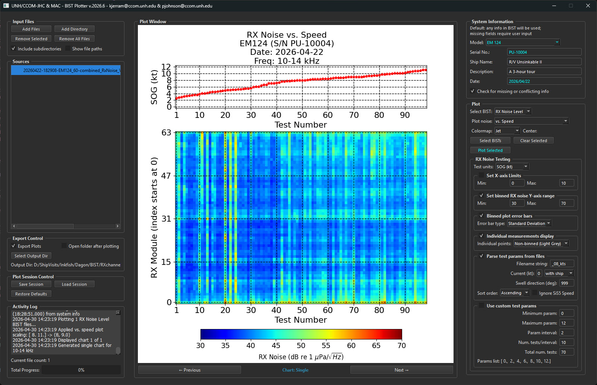

# BISTplotter



A graphical tool for analyzing and visualizing Kongsberg multibeam echosounder Built-In Self-Test (BIST) files. BISTplotter helps assess EM multibeam system performance and hardware health by parsing and plotting various BIST test results.

## Features

BISTplotter supports multiple BIST test types:

- **TX Channels Impedance** - Plot impedance of TX channels at the transducer, measured through the TRU
- **RX Channels Impedance** - Plot impedance of RX channels measured at the receiver and at the transducer (heatmap, line+heatmap, and history views; multi-frequency files such as EM712 55/85 kHz are navigable per frequency)
- **RX Noise Level** - Plot noise levels perceived by the RX system across all channels
- **RX Noise Spectrum** - Visualize RX spectrum BIST data collected at different speeds and headings *(parser/plotter support is limited)*

The application provides an intuitive GUI for:
- Loading and managing multiple BIST files
- Interactive plotting with navigation controls
- System information tracking (model, serial number, date)
- Customizable test parameters
- Export capabilities for analysis results (exported figure sizes/layouts are independent of the on-screen window size)
- **About view on startup** – The Plot Window shows program info (logo, version, freeze date, developers, NSF support) until data is plotted
- **Resizable window** – Only the middle Plot Window grows or shrinks; left and right columns stay fixed width and scroll when needed
- **Dark theme** – GUI uses a dark theme regardless of system settings (plot area keeps default white background)
- **Plot Style** – The pulldown follows the BIST type. RX Noise keeps its modes (vs. Speed, 1 kt / 2 kt binned, vs. RPM, vs. Pitch in deg or %, binned RPM/Pitch, and vs. Azimuth), plus sort order and Ignore SIS5 Speeds where those apply. TX Channels and RX Channels offer **Plot All** (the usual charts plus history) and **History** (history only). Switching to TX or RX Channels starts on Plot All; returning to RX Noise restores the previous noise mode
- **RX noise range** – Checked by default (30–70 dB). Sets the Y axis on binned line plots and the color ramp on RX noise heatmaps. Values below Min are black and values above Max are magenta. Unchecked, the line-plot axis and both heatmap color ranges follow the data being plotted
- **Binned calculated mean** – Checked by default. Choose **Arithmetic & Linear Mean** (default), **Arithmetic Mean**, or **Linear Mean**. The arithmetic mean averages the dB values. The linear mean averages amplitudes and converts the result back to dB. Choosing a mean sets the error-bar type to the matching standard deviation (linear standard deviation when both means are shown). The error-bar type can then be changed on its own
- **Binned plot error bars** – **Standard Deviation Linear** (default), **Standard Error Linear**, **Standard Deviation Arithmetic**, and **Standard Error Arithmetic**. Linear bars sit on the blue linear mean. Arithmetic bars sit on the green arithmetic mean. Standard error divides the spread by the square root of the number of tests in the bin
- **RX Noise Filtering** – **Transient Filter** is off by default (threshold 70 dB). A test is a bad transient when the power-mean level of its modules is above that threshold; each frequency is judged separately. Flagged tests produce a Raw chart and a Filtered chart. If none are flagged, only the usual chart is shown. **Remove Null Values** is on by default and blanks module readings at or below 0 dB on both Raw and Filtered charts. It does not create an extra chart
- **System information on titles** – A model, serial number, or date that conflicts across the loaded files is left off plot titles until that field is edited. A field the user clears is omitted, with no fallback to the parsed value. A confirmed serial number stays confirmed on later plots, including filtered charts
- **Colormaps** – Jet, Inferno, Hot, RedBlue, CoolWarm, and Reversed Managua. Inferno and Hot use custom ranges (bottom at step 40 and 24 respectively). RedBlue, CoolWarm, and Reversed Managua support a configurable **Center** (inflection point in dB, default 55)
- **TX/RX channel out-of-range coloring** – TX and RX channel heatmaps indicate values outside the colorbar range using black (below min) and magenta (above max), including colorbar extend indicators; per-frequency impedance limits from SIS 5 files (e.g. EM712) are applied when regenerating GUI plots
- **Heatmap hover tooltips** – GUI tooltips (upper-left corner) show per-cell values:
  - TX Channels style-1 heatmap: TX Slot, TX Channel, Impedance
  - RX Channels heatmap: RX Channel, RX Board, Impedance
- **Out-of-spec text reports** – When you plot TX or RX Channels BIST, report files are written to the output directory:
  - `TX_OOS_EM<model>_SN_<sn>_from_text_file_<filename>.txt` — TX channel, TX slot, impedance (ohms)
  - `RX_ARRAY_OOS_EM<model>_SN_<sn>_from_text_file_<filename>.txt` — test, frequency, RX board, RX channel, impedance, and spec limits
- **TX Channels GUI** – Navigate all three TX views in the plot window (style 1 heatmap, style 2 line+grid, and TX history). TX history uses GUI-friendly title/legend sizing and layout; exported history plots are unchanged
- **SIS 5 TX slot parsing** – Combined TX BIST files with multiple impedance tables (e.g. slots 1–10 and 11–14) are concatenated correctly; slot axis labels use a fixed interval and match the real slot count (no phantom extra columns)
- **TX plot layout** – Style-1 TX heatmaps are centered under the plot title in the GUI (colorbar included in layout)

## Download

Pre-built executables are available in the [Releases](https://github.com/seamapper/BISTplotter/releases) section. Download the latest release for your operating system.

## Requirements

### For Running the Executable
- Windows, macOS, or Linux (depending on the release)
- No additional dependencies required

### For Running from Source
- Python 3.8 or higher
- PyQt6
- NumPy
- Matplotlib

## Installation

### Using the Executable (Recommended)

1. Go to the [Releases](https://github.com/seamapper/BISTplotter/releases) page
2. Download the appropriate executable for your operating system
3. Extract and run the executable

### Running from Source

1. Clone the repository:
   ```bash
   git clone https://github.com/seamapper/BISTplotter.git
   cd BISTplotter
   ```

2. Install dependencies:
   ```bash
   pip install PyQt6 numpy matplotlib
   ```

3. Run the application:
   ```bash
   python bist_plotter.py
   ```

## Usage

1. **Select BIST Test Type**: Choose the type of BIST test you want to analyze from the dropdown menu
2. **Load Files**: Click "Add Files" to select one or more BIST text files
3. **Enter System Information**: Provide the multibeam model, serial number, and test date (or allow values parsed from the files)
4. **Configure Parameters**: Adjust any custom parameters as needed (for RX Noise, set plot type, units, colormap, sort order, etc.)
5. **Plot**: Click **Plot Selected** to generate visualizations in the Plot Window
6. **Navigate**: Use Previous / Next to browse multiple charts (frequencies, Raw/Filtered pairs, or plot styles)
7. **Export**: Use **Export Plots** to save figures at the standard export sizes (not the on-screen window size). TX channel PNG names are `TX_Z_EM<model>_SN_<sn>_<filename>_v<style>.png`. Use **Export Analysis** to save the loaded files and plot settings to JSON, and **Import Analysis** to restore them and replot. **Remove All Files** clears the file list and the plots, and returns the Plot Window to the startup credit page

### Input File Formats

- **TX Channels Impedance**: Text file saved from a telnet session running all TX Channels BISTs (these results are not saved to text file when running BISTs in the SIS interface)
- **RX Channels Impedance**: Standard BIST text file saved from the Kongsberg SIS interface
- **RX Noise/Spectrum**: BIST text file, ideally with multiple (10-20) BISTs saved to one text file for better statistical analysis

### Tips

- For RX Noise analysis, collect 10-20 BISTs per condition (e.g., per speed) to reduce the impact of transient noises. The Transient Filter can drop tests whose module average is above the dB threshold, and Remove Null Values blanks readings at or below 0 dB
- Save one text file per condition (e.g., one file per vessel speed) for organized analysis
- Factory limits for acceptable BIST levels are automatically parsed from the text file when available (including per-frequency RX limits on multi-frequency SIS 5 systems)
- For **SIS 5 TX Channels** combined files, impedance may appear in multiple blocks (separate slot-index header rows per group of slots); the plotter merges them into one heatmap
- Out-of-spec reports are generated automatically when plotting; check the output directory and the Activity Log for filenames
- Resize the main window as needed; side panels scroll so controls remain usable while the plot area expands

### Output reports (TX / RX Channels)

| Report | When generated | Contents |
|--------|----------------|----------|
| `TX_OOS_*.txt` | TX Channels plot | TX Channel (0-based), TX Slot (1-based), impedance |
| `RX_ARRAY_OOS_*.txt` | RX Channels plot | Out-of-spec RX array elements with test, frequency, board, channel, and limits |

If no elements are out of spec, the report still states that explicitly.

## Supported Systems

BISTplotter was developed and tested primarily with:
- **EM302** (SIS 4 format)
- **EM710** (SIS 4 format)
- **EM122** (SIS 4 format)
- **EM712 / EM714** (SIS 5, including multi-frequency RX Channels such as 55 and 85 kHz)
- **EM2040** (with some limitations for RX Noise BIST files)
- **EM304** and other SIS 5 systems with split TX impedance tables

SIS 5 model parsing extracts model numbers (e.g. EM2040, EM304, EM712) from the BIST header. Support for other formats and features may require additional development.

## Known Limitations

- `N_RX_boards` is typically 4, but in some cases will be 2; this is currently set manually and will eventually be detected automatically
- EM2040 RX Noise BIST files may include columns corresponding to frequency, not RX board; additional development is needed to handle this smoothly, especially between SIS 4 and SIS 5 formats
- RX Noise Spectrum plotting is not fully implemented
- All impedance tests are meant as proxies for hardware health and not as replacement for direct measurement with Kongsberg tools

## Version

Current version: **2026.19** (see `version.py`)

## Authors

- **kjerram** - Initial work and vision
- **pjohnson** - Further development 

## License

This project is licensed under the BSD 3-Clause License - see the [LICENSE](LICENSE) file for details.

Copyright (c) 2025–2026, Center for Coastal and Ocean Mapping, University of New Hampshire

## Acknowledgments

Developed at the Center for Coastal and Ocean Mapping (CCOM) at the University of New Hampshire, in collaboration with the Joint Hydrographic Center (JHC) and the Multibeam Advisory Committee (MAC).

This work was supported by the National Science Foundation under:
- Award #1933720 — *Collaborative Research: Optimization of the Multibeam Sonar Systems of the U.S. Academic Fleet through Coordinated System Testing, Tool Development, and Community Outreach*
- Award #2614984 — *Advancing U.S. Leadership in Seafloor Mapping Technology for the Academic Research Fleet*

## Contributing

Contributions are welcome! Please feel free to submit a Pull Request.

## Issues

If you encounter any problems or have feature requests, please open an issue on the [GitHub Issues](https://github.com/seamapper/BISTplotter/issues) page.
